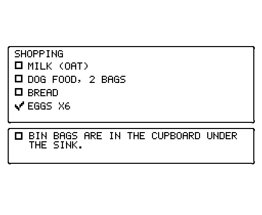
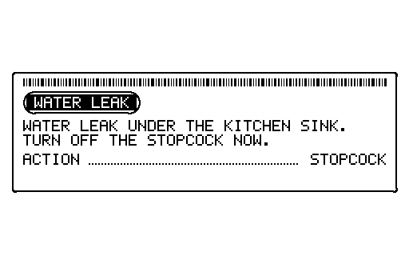

# printarr

printarr is a small service that prints receipt-style "strips" on an Epson TM-T88V
(80 mm, ESC/POS). Home Assistant, Hermes and the web page send it messages, briefings,
lists and alerts. It lays them out in one design language, keeps each person's
waiting items in their own pile, and prints on the right moment.

<p align="center">
  
  
  
</p>

<p align="center"><sub>Sample strips drawn by the app's own renderer (<code>scripts/render_readme_samples.py</code>).</sub></p>

## What it does

- **Two recipients**, `yannic` and `wife`, shown with the names set in the setup wizard. Each has a pile of waiting items that
  prints as one continuous piece of paper, cut once at the end, when Home Assistant releases it:
  in the morning when the phone is unplugged, and in the evening when someone arrives home.
  The briefing goes on top and the rest follow in the order they were queued.
- **Composed tickets.** A ticket is an ordered list of typed blocks: greeting, metric, metric rows,
  graph, dog counts, message, alert, checklist, tip and fact. Every block is its own bordered tile on
  a three-column grid, and the tiles fall together into rows. Each block has a mood that changes how it looks.
- **Briefing preset.** `POST /api/v1/tickets/compose` with `preset: "briefing"` lays out the fixed morning
  or evening briefing: greeting, three metrics with sparklines, one graph, a body and a fun fact.
  A briefing that sends no greeting is headed by the recipient's name, so every strip says who it is for.
- **Three deliveries.** `on_release` waits in the pile, `at` prints at a time, and `now` prints straight away.
- **Live data.** Entity values and sparklines are read from Home Assistant when the ticket prints,
  not when it is queued.
- **Simple text too.** Plain messages go through `POST /tickets`, and the layout is picked for you.
- **Web page** at `/` to write tickets, preview them, watch the inbox and history, and change settings.
- **Built for agents.** Every request is validated against a schema, and a 422 says what is wrong with it. [`docs/agents/hermes-skill/SKILL.md`](docs/agents/hermes-skill/SKILL.md) teaches an agent (Hermes) the whole API.
- **Telegram pings** for threads that need the owner to act: `POST /api/v1/notify`, one message a minute per caller.
- **Look at what printed.** Each ticket that reached the printer keeps a PNG, so a bad print can be checked from the API.
  The time and a short code print under each cut. `GET /api/v1/prints/{code}` finds that piece again, and a ticket in a piece shows the whole piece.
- **Safe for the paper.** A ticket interrupted by a crash is marked `failed` rather than printed twice. The queue
  pauses while the printer reports a fault, and held items wait until you release them.

## Architecture

```
  Home Assistant ──REST──┐                 ┌── SQLite (/data/printarr.db)
  Hermes agent ──REST────┼──► printarr API ─┼── scheduler (prints when due)
  Web page ──────────────┘   (FastAPI)     └── backups (nightly, versioned schema)
                                  │
                                  └── raw TCP 9100 ──► TM-T88V printer
                                                       (or the simulator on the laptop)
```

- `app/main.py` holds the routes. `app/compose.py` and `app/blocks.py` validate and fill blocks.
  `app/render/` draws strips from the design tokens in `app/render/system/`.
- `app/scheduler.py` prints due tickets and releases piles. `app/status.py` decodes the printer's DLE EOT status.
- The SQLite store owns all state. Only one uvicorn worker may run, because the scheduler lives in the process.

## Quick start

### On a laptop with the simulator

```bash
docker compose -f docker-compose.dev.yml up --build
```

The web page is at <http://localhost:8000/>. The simulator is at <http://localhost:8080/>.
Data is kept in `./dev-data`. On a fresh install, finish the setup wizard at `/` first. Until setup is done, the
API answers only the setup routes and health.

### From source

```bash
pip install -r requirements-dev.txt
pytest
PRINTARR_PRINTER_MODE=file PRINTARR_OUTPUT_DIR=./out uvicorn app.main:app --port 8000
```

`file` mode writes each job as a `.bin` file in `PRINTARR_OUTPUT_DIR`, which needs no printer.

### Try the API (after setup)

```bash
curl -X POST localhost:8000/api/v1/tickets \
  -H 'Content-Type: application/json' \
  -d '{"recipient":"wife","sender":"yannic","title":"Dinner","message":"Pasta at 7","send_at":"2026-10-24T18:00:00"}'
```

## Install on TrueNAS

The one-file install, the upgrade steps and the rollback steps are in
[`docs/deploy/truenas.md`](docs/deploy/truenas.md). In short:

1. Create the data folder (for example `/mnt/ssd/apps/printarr`) and give it to uid and gid 568, the TrueNAS app user:
   `chown -R 568:568 /mnt/ssd/apps/printarr`.
2. In `docker-compose.yml`, change only the data folder. The file holds the image, memory, ports and storage, and nothing secret.
3. In TrueNAS, go to Apps, Install Custom App, and paste the file.
4. Open `http://<nas-ip>:30100/`. The setup wizard asks for the printer, Home Assistant, the model server, Telegram,
   names and timezone. Each service has a Test button. Finishing setup saves everything in the data folder.
   The setup code is printed in the container log, and the API stays closed until setup is finished.

The image is built by [`.github/workflows/image.yml`](.github/workflows/image.yml) and pushed to
`ghcr.io/ourrage-cmyk/printarr` on every push to `main`. The package must be public for TrueNAS to pull it
without a login.

## Connect Home Assistant and Hermes

- **Home Assistant:** create a long-lived access token, paste it into the setup wizard or the settings page, and press Test.
  The setup steps and the example automations are in [`docs/integrations/`](docs/integrations/SETUP-CHECKLIST.md).
- **Hermes:** give the agent [`docs/agents/hermes-skill/SKILL.md`](docs/agents/hermes-skill/SKILL.md) as its instructions and
  [`docs/integrations/hermes/openapi.yaml`](docs/integrations/hermes/openapi.yaml) as its tool definition.
  [`docs/integrations/hermes/example-morning-briefing.md`](docs/integrations/hermes/example-morning-briefing.md)
  shows one briefing from start to finish.

## API

The full schema is [`docs/openapi.json`](docs/openapi.json). The running service also serves `/docs`.
The main routes:

| Method | Path | Purpose |
| --- | --- | --- |
| `GET` | `/api/v1/blocks`, `/api/v1/blocks/{name}/schema` | Block types, moods and their slot schemas |
| `POST` | `/api/v1/tickets/compose` | Queue a ticket made of blocks, or a briefing from `preset` and `slots` |
| `POST` | `/api/v1/tickets/slots` | Queue a briefing (101) or note (102) from typed slots |
| `POST` | `/api/v1/tickets` | Queue plain text |
| `POST` | `/api/v1/tickets/preview` | See the text of a plain ticket without queueing it |
| `GET` | `/api/v1/tickets`, `/api/v1/tickets/{id}` | List tickets, or read one with its status and last error |
| `POST` | `/api/v1/tickets/{id}/cancel`, `/retry`, `/release` | Cancel, print again, or release a held ticket |
| `POST` | `/api/v1/people/{person}/release` | Print a person's pile now |
| `POST` | `/api/v1/holds/{hold_key}/release` | Release every held ticket with that key |
| `GET` | `/api/v1/insights/entities` | Ranked Home Assistant entities for a briefing |
| `GET` | `/api/v1/log`, `/api/v1/log/summary`, `/api/v1/log/export` | History |
| `GET` / `PUT` | `/api/v1/settings/ha`, `/settings/model`, `/settings/alerts` | Settings (tokens are never returned in full) |
| `POST` | `/api/v1/settings/ha/test`, `/alerts/test`, `/printer/test` | Check Home Assistant, Telegram and the printer |
| `GET` | `/api/v1/printer`, `/printer/self-check` | Printer status (the self-check prints nothing) |
| `GET` | `/api/v1/health`, `/api/v1/metrics`, `/healthz` | Health for Uptime Kuma, counters, liveness, and the build (`version`, `git_sha`) |
| `POST` | `/api/v1/notify` | Send a Telegram message to the owner (one a minute per caller) |
| `GET` | `/api/v1/ticket-images`, `/api/v1/tickets/{id}/image` | Recent ticket PNGs, and the PNG of one ticket as sent to the printer (a ticket in a piece shows the whole piece) |
| `GET` | `/api/v1/prints/{code}` | Finds a printed piece and its tickets by the code printed under the cut, next to the print time |
| `GET` / `POST` | `/api/v1/backup/export`, `/backup/import` | Download or restore the database |

Ticket statuses: `held`, `pending`, `printing`, `sent`, `failed`, `cancelled`.

**There is no authentication.** The API is for the home LAN only. Do not expose port 8000 to the internet.

## Design language

Every block is its own outlined tile on a three-column grid, with no shell around the whole ticket.
There are three text sizes and no others: large dot matrix (5x7, titles only, centred), medium solid (numbers),
and small solid (everything else). A long title wraps to up to three lines at the one dot size, then ends in
an ellipsis. The paper carries no blank of its own: the half inch before the cut is fed with the cut
command, once at the end of the whole piece, so continuations and queued tickets flow with only a tile gap.
A fun fact prints its text alone, with no label.

The tone sets the feeling at a glance, with one ornament and one icon per tone:

Each card carries its mood in a band at the top, 28 dots tall (under 5 mm), never in words:

- **Plain:** `neutral`, `factual`. **Dots:** `loving`, `happy`. **Zigzag:** `excited`, `playful`.
- **Ticks:** `reminder`. **Stipple:** `sad`, `confused`. **Hatch:** `gentle_warning`, `upset`.
- **Barcode:** `firm_complaint`, `urgent`. **Solid black bar with an inverted title:** `critical`, the only one.
- **Heart:** only `loving` has a heart.

Five block types wear a small mark at the top-right corner of their card: a note (`message`) an envelope, an alert (`alert`) a bolt, a reminder (`tip`) a clock, a fun fact (`fact`) a bulb, and a shopping list (`checklist`) a cart. The mark follows the block, not the `kind` field. The outline follows the tone: heavy square corners for `urgent`, `upset` and `firm_complaint`, the heaviest for `critical`, and rounder corners for `loving`, `gentle_warning`, `playful` and `happy`. Printed tickets never print the tone name.
The rules and the reasons behind them are in [`docs/design/README.md`](docs/design/README.md), the
design tokens are in [`docs/design/system/tokens.json`](docs/design/system/tokens.json), and the taste
guide is in [`docs/design/taste-guide/taste-guide.html`](docs/design/taste-guide/taste-guide.html).

## Configuration

Settings are entered in the setup wizard (the web page at `/`) and saved in the data folder. Secrets such as the
Home Assistant and Telegram tokens are stored there and are never returned by the API. Change them later at
`/setup` with the setup code from the log. The compose files hold only the image, memory, CPUs, ports and storage.

## Monitoring and alerts

- **Health for Uptime Kuma:** `GET /api/v1/health` returns 200 when the database and printer are fine, and 503
  when the printer is unreachable. Kuma polls the service, nothing is pushed.
- **Telegram alerts:** enter the bot token and chat ID in the setup wizard or the settings page, then press Send test message. Alerts cover
  an unreachable printer, paper out, cover open, autocutter error, a rendering failure, a ticket that failed after
  retries, and a decision model that is down. Each problem alerts once, and a recovery message follows.
- **Printer status:** read with DLE EOT every minute. The bit layout comes from the Epson ESC/POS Command Reference.

## Data, upgrades and backups

- The database schema is versioned (SQLite `user_version`). Each start applies only the steps that are missing, and
  never drops data. Before an upgrade, a copy is written to `backups/pre-upgrade-v<n>-<time>.db`.
- A database from a newer version is refused, so an older image cannot damage it.
- Download a copy at any time with `GET /api/v1/backup/export`. Restore with `POST /api/v1/backup/import?confirm=replace`.
- With the API stopped, restore from a file in the container: `python -m app.backup restore /data/backups/<file>.db`.

## Printer facts

- 80 mm paper, 512 printable dots, Font A at 42 columns. Text is CP437. Characters outside it print as `?`.
- Commands verified against the ESC/POS Command Reference: `GS !`, `GS V 1`, `GS ( L` function 112 and 50, and `DLE EOT` status 1 to 4.
- Still to check on the real unit: the USB ID, tone levels for multi-tone images, and a status round trip.
- The simulator is a TCP target too. Enter its address as the printer in the setup wizard, and send the sample jobs with
  `python -m app.send_sample <host> 9100`.

## Development

```bash
pip install -r requirements-dev.txt
pytest
python -m app.openapi_export        # refreshes docs/openapi.json
python scripts/render_readme_samples.py   # refreshes docs/images (needs pillow)
```

Golden-byte tests in `tests/test_golden.py` pin the exact bytes for the sample jobs. They guard against changes
to this encoder. They are not checks against Epson's programming guide.

The test suite also checks that `docs/openapi.json` matches the code, and that every route named in the README
and the agent skill exists.

## Documentation

- [`docs/STATUS.md`](docs/STATUS.md): what has been built, and what is still open.
- [`skills/printarr/SKILL.md`](skills/printarr/SKILL.md): the agent skill for the API.
- [`docs/deploy/truenas.md`](docs/deploy/truenas.md): install, upgrade, roll back and restore.
- [`docs/integrations/`](docs/integrations/SETUP-CHECKLIST.md): Home Assistant and Hermes setup.
- [`docs/design/`](docs/design/README.md): design system, taste profile and templates.
